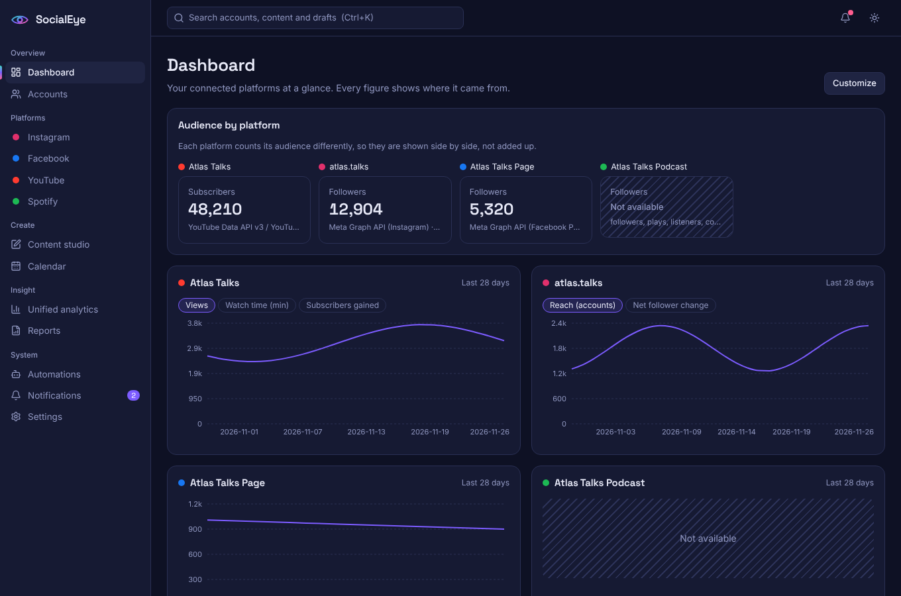

# SocialEye

**Local-first, open-source desktop app for managing Instagram, Facebook, YouTube and Spotify podcasts — content, publishing, analytics and notifications in one place.**

Windows 10/11 · English & Português (Portugal) · MIT licensed · No telemetry · No SocialEye server


<sub>Screenshot uses illustrative sample data.</sub>

## What it does

| Area | Highlights |
|---|---|
| **Accounts** | Official OAuth 2.0 sign-in (PKCE + loopback). Multiple YouTube channels, Facebook Pages, Instagram professional accounts and podcasts. Tokens live in Windows Credential Manager. Token-expiry monitoring, reconnection, manual and automatic sync. |
| **YouTube** | Channel stats, every upload with views/likes/comments, watch time, average view duration and % viewed, daily analytics, traffic sources, demographics, top countries, per-video audience retention, Shorts detection, comment moderation, resumable video upload with progress, editing title/description/visibility of existing videos, custom thumbnails, native scheduling. |
| **Instagram** | Followers/following counts, reach and daily follower change, media with likes/comments, comment moderation, publishing (images/reels from a public URL), local scheduling. **Follower analysis from your official data export**: who doesn't follow you back, mutuals, new followers and unfollowers between exports (JSON and HTML). |
| **Facebook** | Pages (never personal profiles — Meta's API doesn't allow it), followers, reach, engagement, page views, posts with reactions/comments/shares, comment moderation, text/link/photo publishing, native scheduling. |
| **Spotify** | Podcast catalogue (episodes, release dates, durations, release calendar). Plays/listeners/followers imported from **Spotify for Creators CSV exports**, because no public API exposes them. |
| **Content studio** | Drafts, per-platform versions, platform-specific validation (length, hashtags, media, schedule windows), media library with previews, templates, publishing history, calendar. |
| **Unified analytics & reports** | Side-by-side platform comparison that never adds up metrics that mean different things, period-over-period changes, publishing frequency, top content. Export to **PDF, CSV and Excel**. |
| **Automations** | Rules (thresholds, growth, new content/comments, sync/publish failures, expiring authorization) → in-app and desktop notifications. Automations never publish or delete. |
| **Data** | SQLite with versioned migrations, history of every metric, backup/restore, full JSON export, audit log. |

### Honesty rules

SocialEye never invents numbers. Every figure shows its source and date; metrics a platform doesn't provide are shown as **Not available** (hatched) with the reason — never as zero. Operations an API doesn't support return a structured "unsupported" response with the manual alternative. See [docs/LIMITATIONS.md](docs/LIMITATIONS.md).

## Install

Download the latest installer (`.exe` or `.msi`) from [Releases](../../releases). Then follow [docs/API_SETUP.md](docs/API_SETUP.md) to create your own developer app for each platform you want to connect — SocialEye talks to the platforms directly with **your** credentials.

## Develop

Requirements: Node.js 22+, Rust (stable), and on Windows the [Tauri prerequisites](https://tauri.app/start/prerequisites/) (WebView2, MSVC build tools).

```bash
npm ci
npm run tauri dev        # run the app
npm test                 # frontend tests (Vitest)
npm run lint && npm run typecheck
cd src-tauri && cargo test && cargo clippy --all-targets -- -D warnings
npm run tauri build      # Windows installers in src-tauri/target/release/bundle
```

`npm run dev` alone runs the UI in a browser without the Rust backend (useful for styling; it shows a banner and no data).

## Documentation

- [API & OAuth setup](docs/API_SETUP.md) — developer accounts, approvals and redirect URIs per platform
- [Architecture & database](docs/ARCHITECTURE.md)
- [Platform limitations](docs/LIMITATIONS.md)
- [Troubleshooting](docs/TROUBLESHOOTING.md)
- [Release process](docs/RELEASE.md)
- [Guia em Português](docs/GUIA_PT.md)
- [Contributing](CONTRIBUTING.md) · [Security](SECURITY.md) · [Code of Conduct](CODE_OF_CONDUCT.md) · [Changelog](CHANGELOG.md)

## License

[MIT](LICENSE)
